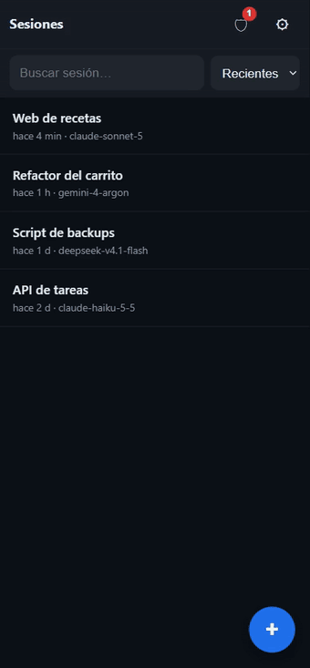
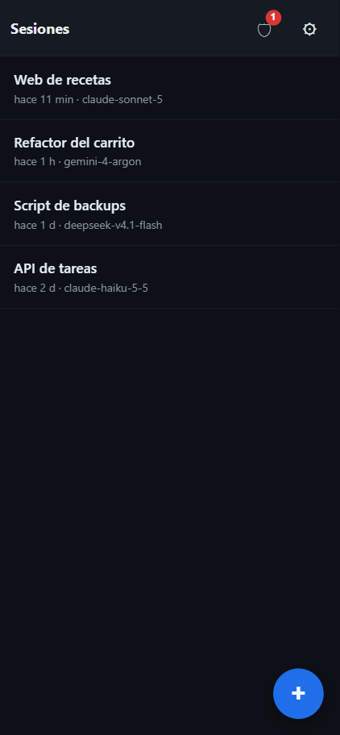
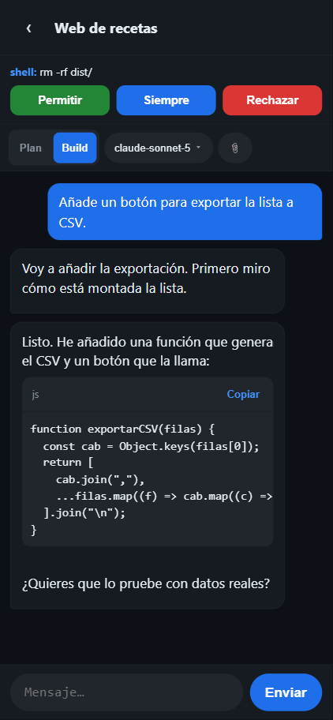
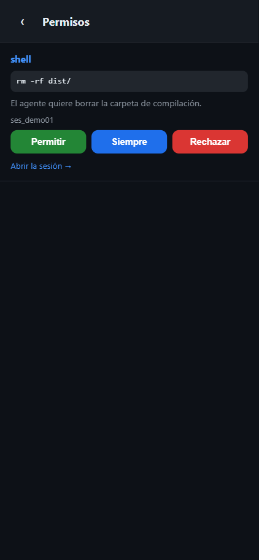

# OpenCode Móvil — PWA client for opencode

> ⚠️ **Disclaimer / Aviso**: this is an **unofficial, community-made** project.
> It is **not built by the OpenCode team** and is **not affiliated with or
> endorsed by** [opencode](https://opencode.ai) or Anomaly in any way.
> «opencode» is used only to describe what this app connects to.
>
> Este es un proyecto **no oficial** hecho por la comunidad. **No está
> desarrollado por el equipo de OpenCode** ni está **afiliado ni respaldado** por
> [opencode](https://opencode.ai) o Anomaly.

[](LICENSE)
[](#-features)
[](#-features)
[](#-tests)
[](#-features)
[](https://github.com/axi010/opencode-mobile-pwa/stargazers)

▶️ **[Try the live demo](https://axi010.github.io/opencode-mobile-pwa/)** — fake data, nothing to install.

<p align="center">
  
</p>

<p align="center">
  
  
  
</p>

A **mobile Progressive Web App** to drive your [opencode](https://opencode.ai) server from your phone: chat with your sessions in real time, approve permissions, pick the model, browse your project's files and attach them, all from a tiny, dependency-free client.

> **Español:** [Ir a la versión en español](#-español)

▶️ **[Prueba la demo](https://axi010.github.io/opencode-mobile-pwa/)** — datos ficticios, sin instalar nada.

<p align="center">
  
</p>

<p align="center">
  
  
  
</p>

---

## ✨ Features

- **Real-time chat** with streaming responses (SSE), reasoning, tool chips and a stop button.
- **Search** inside a conversation (highlight + jump between matches) and **copy the whole chat as Markdown**.
- **Session list with search and sorting** (recent / oldest / name).
- **System view**: MCP servers (connect/disconnect), model providers, plugins, skills and commands.
- **Bilingual UI** (Spanish / English), auto-detected from your browser.
- **Resilient connection**: the event stream reconnects with **exponential back-off** (1 s → 30 s + jitter).
- **Permission control**: approve or reject what the agent asks for (**once / always / reject**), right from your phone. Live banner in the chat, badge counter in the session list and a dedicated screen.
- **Plan / Build mode switch**: flip the agent's mode with one tap.
- **Model + variant picker**: 130+ models from all your providers, with search and per-model reasoning variants (`low`…`max`).
- **Attach files** from the PC: browse your project folders and reference files in your prompt.
- **Security**: strict CSP in production, **PIN lock** (PBKDF2, brute-force cooldown, auto-lock on inactivity), QR token scrubbing from the URL, "log out" button.
- **Light / dark / auto theme**, following your system.
- **Local notifications** when the agent needs a permission while you are not looking at the app.
- **No frameworks**: vanilla JS + a ~20-line DOM helper. ~50 kB gzipped.

## 📱 Platform support

| Feature | Android | iOS (iPhone/iPad) | Desktop |
| --- | --- | --- | --- |
| Chat, sessions, permissions, model picker, attach files | ✅ | ✅ | ✅ |
| PIN lock (needs HTTPS) | ✅ | ✅ | ✅ |
| Install as an app | ✅ | ✅ (Share → *Add to Home Screen*) | ✅ (Chrome/Edge) |
| In-app alerts (badge 🛡, chat banner) | ✅ | ✅ | ✅ |
| System notification when the app is **closed** | ✅ (~30 s window) | ⚠️ **only if installed** + no background wake | ✅ |
| Background push | ❌ | ❌ | ❌ |

**Notes**

- **iOS**: Apple only allows web apps **installed on the Home Screen** to notify
  (since iOS 16.4). Even then, iOS does not allow waking the app in the
  background, so a notification only arrives shortly after you leave the app.
  The app detects this and tells you what to do. Also: iOS does **not** run the
  PIN over plain `http://` (needs HTTPS) — use the tunnel.
- **Windows / macOS / Linux as the server**: the file browser works with either
  path separator, so attaching files works with an opencode server on any OS.
- **No push server**: notifications are local. Real background push would need a
  small server of your own (see the roadmap).


- [opencode](https://opencode.ai) desktop or CLI installed and running on your PC (the server listens on `127.0.0.1:28894`).
- Node.js 18+ to build and serve the PWA.

## 🚀 Quick start

**Just want to look?** → [live demo](https://axi010.github.io/opencode-mobile-pwa/) (fake data, no install).

**Want to use it for real?** You need an **opencode** server running on your PC:

```bash
git clone <this-repo>
cd opencode-mobile
npm install

# Development (hot reload), reachable from your LAN:
npm run dev            # http://localhost:5173

# Production build + serve (with the /api proxy the app needs):
npm run build
npm run preview        # http://localhost:4173

# Unit tests (no dependencies, uses Node's built-in runner):
npm test
```

Then open the app and connect:

```bash
# Generate a QR with a 30-day token and scan it with your phone:
node scripts/qr-pairing.mjs http://<your-lan-ip>:5173
```

### HTTPS access from the phone (recommended)

Some features (**PIN lock, service worker, notifications**) require a *secure context*. `http://localhost` counts, but a LAN IP does not. To get real HTTPS:

```powershell
# Windows
pwsh scripts/movil.ps1
```

```bash
# macOS / Linux
bash scripts/movil.sh
```

It starts the preview, opens a Cloudflare quick tunnel and generates a QR pointing to the HTTPS URL. Requires [cloudflared](https://developers.cloudflare.com/cloudflare-one/connections/connect-networks/downloads/).

## 🧠 How it connects

The opencode API only allows CORS from loopback, so the PWA talks to `/api` **on its own origin** and the Vite dev/preview server proxies it to `127.0.0.1:28894` (see `vite.config.js`). This makes it work identically on `localhost`, on your LAN and through the tunnel.

## 🔒 Security notes

- The **server password is never written to disk** in the repo; the QR script reads it from the opencode CLI in memory.
- A **QR contains a 30-day token** (equivalent to the password). Treat it as a secret.
- The app stores the credential in the phone's `localStorage`.
- **PIN lock** is local to the device (PBKDF2-SHA256, 150k iterations, per-failure back-off).

## 🗂 Project layout

```
opencode-mobile/
├── index.html
├── vite.config.js          # base path, /api proxy, strict CSP for production builds
├── public/                 # manifest, service worker, icons
├── scripts/
│   ├── qr-pairing.mjs      # generate the access QR (cross-platform)
│   ├── movil.ps1 / movil.sh # one-shot: preview + cloudflare tunnel + QR
│   ├── recortar-captura.ps1 # crop screenshots to phone size
│   └── generar_iconos.ps1
├── test/
│   └── unit.test.js        # unit tests (Node's built-in runner)
└── src/
    ├── main.js             # bootstrap, routes, theme, lock
    ├── api/client.js       # HTTP + SSE client
    ├── security.js         # PIN (PBKDF2), inactivity lock
    ├── theme.js            # light/dark/auto
    ├── notify.js           # local notifications
    ├── permisos-avisos.js  # background permission watcher
    ├── ui/                 # dom.js, router.js, chat-controls.js
    └── views/              # setup, sessions, chat, permissions, settings
```

## 🧪 Tests

Unit tests cover the logic without a DOM: **markdown rendering** (safe escaping,
code blocks, lists), `timeAgo`, and the **path utilities** of the file browser
(which must work against an opencode server on Windows, macOS and Linux). They
use **Node's built-in test runner**, so they add **no dependencies**:

```bash
npm test
```

## 🤝 Contributing

**Everyone is welcome!**This is a small, framework-free project — easy to read and easy to hack on.

- 🟢 **New here?** Check the pinned issues
  [**👋 Ideas para colaborar**](https://github.com/axi010/opencode-mobile-pwa/issues/1)
  (easy tasks) and the [**🗺️ Roadmap**](https://github.com/axi010/opencode-mobile-pwa/issues/2).
- 📖 Read [**CONTRIBUTING.md**](CONTRIBUTING.md) for the setup and the two hard
  design rules (no UI framework, no inline scripts/styles).
- 🐛 Found a bug? Open an issue — there is a template for it.
- 💡 Have an idea? Use the **Feature request** template (explain the *problem* first).
- 🔒 Security problem? **Do not open a public issue** — see [SECURITY.md](SECURITY.md).

No contribution is too small: a typo fix, a translation, a screenshot or a bug
report all help. If you are unsure, open a *Discussion* and ask. 🙌

## 📄 License

MIT — see [LICENSE](LICENSE).

---

# 🇪🇸 Español

Un **cliente PWA para móvil** que te permite manejar tu servidor [opencode](https://opencode.ai) desde el teléfono: chatear con tus sesiones en tiempo real, aprobar permisos, elegir el modelo, explorar los archivos de tu proyecto y adjuntarlos, todo con un cliente pequeño y sin dependencias.

## ✨ Qué hace

- **Chat en tiempo real** con respuestas en streaming (SSE), razonamiento, chips de herramientas y botón de detener.
- **Buscar dentro de la conversación** (resalta y salta entre coincidencias) y **copiar todo el chat en Markdown**.
- **Lista de sesiones con buscador y orden** (recientes / antiguas / nombre).
- **Vista Sistema**: servidores MCP (conectar/desconectar), proveedores de modelos, plugins, skills y comandos.
- **Interfaz bilingüe** (español / inglés), detectada automáticamente del navegador.
- **Conexión resistente**: el stream se reconecta con **backoff exponencial** (1 s → 30 s + jitter).
- **Control de permisos**: aprueba o rechaza lo que pide el agente (**una vez / siempre / rechazar**) desde el móvil. Banner en vivo en el chat, contador en la lista de sesiones y pantalla propia.
- **Conmutador Plan / Build**: cambia el modo del agente con un toque.
- **Selector de modelo y variante**: más de 130 modelos de todos tus proveedores, con buscador y variantes de razonamiento (`low`…`max`).
- **Adjuntar archivos** del PC: navega por las carpetas de tu proyecto y referéncialos en el mensaje.
- **Seguridad**: CSP estricta en producción, **bloqueo con PIN** (PBKDF2, cooldown antifuerza bruta, cierre por inactividad), borrado del token del QR en la URL y botón de cerrar sesión.
- **Tema claro / oscuro / automático**, siguiendo al sistema.
- **Notificaciones locales** cuando el agente pide un permiso y no estás mirando la app.
- **Sin frameworks**: JS vanilla + un helper DOM de ~20 líneas. Unos 50 kB comprimidos.

## 📱 Compatibilidad de plataformas

| Función | Android | iOS (iPhone/iPad) | Escritorio |
| --- | --- | --- | --- |
| Chat, sesiones, permisos, modelo, adjuntar archivos | ✅ | ✅ | ✅ |
| PIN (necesita HTTPS) | ✅ | ✅ | ✅ |
| Instalar como app | ✅ | ✅ (Compartir → *Añadir a pantalla de inicio*) | ✅ (Chrome/Edge) |
| Avisos en la app (badge 🛡, banner del chat) | ✅ | ✅ | ✅ |
| Notificación del sistema con la app **cerrada** | ✅ (~30 s) | ⚠️ **solo si está instalada** + sin despertar en 2º plano | ✅ |
| Push en segundo plano | ❌ | ❌ | ❌ |

**Notas**

- **iOS**: Apple solo permite notificar a las webs **instaladas en la pantalla de
  inicio** (desde iOS 16.4). Y aun así, iOS **no permite despertar** la app en
  segundo plano, así que el aviso llega solo si acabas de salir de la app. La app
  lo detecta y te dice qué hacer. Además, en iOS el **PIN no funciona por
  `http://`** (necesita HTTPS): usa el túnel.
- **Servidor en Windows / macOS / Linux**: el explorador de archivos funciona con
  cualquier separador de ruta, así que adjuntar archivos va con el servidor
  opencode en cualquier sistema.
- **Sin servidor push**: las notificaciones son locales. El push real en segundo
  plano necesitaría un servidor propio pequeño (ver el roadmap).

## 🔧 Requisitos

- [opencode](https://opencode.ai) instalado y en marcha en tu PC (el servidor escucha en `127.0.0.1:28894`).
- Node.js 18+ para compilar y servir la PWA.

## 🚀 Puesta en marcha

**¿Solo quieres verla?** → [demo](https://axi010.github.io/opencode-mobile-pwa/) (datos ficticios, sin instalar).

**¿Quieres usarla de verdad?** Necesitas un servidor **opencode** en tu PC:

```bash
git clone <este-repo>
cd opencode-mobile
npm install

npm run dev            # desarrollo, accesible desde tu LAN (http://localhost:5173)
npm run build          # build de producción
npm run preview        # sirve el build con el proxy /api (http://localhost:4173)
npm test               # tests unitarios (runner nativo de Node, sin dependencias)
```

Luego genera el QR y escanéalo desde el móvil:

```bash
node scripts/qr-pairing.mjs http://<ip-de-tu-pc>:5173
```

### Acceso por HTTPS desde el móvil (recomendado)

Algunas funciones (**PIN, service worker, notificaciones**) necesitan un *contexto seguro*. `http://localhost` lo es, pero una IP de LAN no. Para tener HTTPS de verdad:

```powershell
pwsh scripts/movil.ps1     # Windows
```

```bash
bash scripts/movil.sh      # macOS / Linux
```

Arranca la preview, abre un túnel rápido de Cloudflare y genera un QR apuntando a la URL HTTPS. Requiere [cloudflared](https://developers.cloudflare.com/cloudflare-one/connections/connect-networks/downloads/).

## 🧠 Cómo se conecta

La API de opencode solo permite CORS desde loopback, así que la PWA habla con `/api` **en su propio origen** y el servidor de Vite lo reenvía a `127.0.0.1:28894` (ver `vite.config.js`). Así funciona igual en `localhost`, en tu LAN y a través del túnel.

## 🔒 Notas de seguridad

- La **contraseña del servidor nunca se guarda en disco** dentro del repo; el script del QR la lee del CLI de opencode solo en memoria.
- Un **QR contiene un token de 30 días** (equivalente a la contraseña). Trátalo como un secreto.
- La app guarda la credencial en el `localStorage` del móvil.
- El **PIN** es local al dispositivo (PBKDF2-SHA256, 150k iteraciones, espera creciente por fallo).

## 🧪 Tests

Cubren la lógica sin DOM: el **render de markdown** (escape seguro, bloques de
código, listas), `timeAgo` y las **utilidades de rutas** del explorador (deben
funcionar con el servidor opencode en Windows, macOS y Linux). Usan el **runner
nativo de Node**: **no añaden dependencias**.

```bash
npm test
```

## 🤝 Cómo colaborar

**¡Cualquiera es bienvenido!** Es un proyecto pequeño y **sin frameworks**: fácil
de leer y fácil de tocar.

- 🟢 **¿Nuevo por aquí?** Mira los issues fijados
  [**👋 Ideas para colaborar**](https://github.com/axi010/opencode-mobile-pwa/issues/1)
  (tareas fáciles) y el [**🗺️ Roadmap**](https://github.com/axi010/opencode-mobile-pwa/issues/2).
- 📖 Lee [**CONTRIBUTING.md**](CONTRIBUTING.md) para el setup y las dos reglas de
  diseño (sin framework de UI, sin scripts/estilos en línea).
- 🐛 ¿Un fallo? Abre un *issue* (hay plantilla).
- 💡 ¿Una idea? Usa la plantilla **Feature request** (explica el *problema* antes).
- 🔒 ¿Problema de seguridad? **No abras un issue público** — mira [SECURITY.md](SECURITY.md).

Ninguna aportación es pequeña: corregir una errata, traducir, una captura o
reportar un bug ayudan. Si dudas, abre una *Discussion* y pregunta. 🙌

## 📄 Licencia

MIT — ver [LICENSE](LICENSE).
